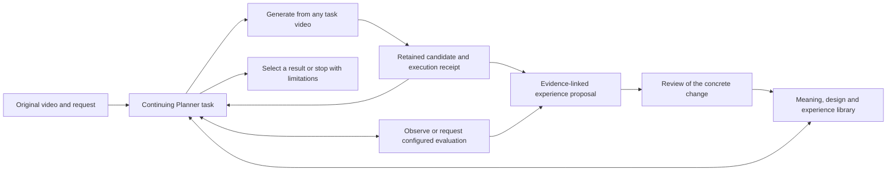

# Continuous Planner loop

[Approved plan](planner-loop-experience-plan.md) · [Planner setup](planner-harness.md) · [Operating manual](../src/planner_harness/OPERATIONS.md) · [Experience map](../knowledge/experience/README.md)

One application-owned task carries the original request, observations, reading receipts, optional notes, all videos and all feedback. GPT-6.1-sol chooses what to inspect, read, generate and finish. Every inference receives the current context; continuity does not depend on a hidden provider conversation. A model-selected result is recorded as a selection, with its stated limitations, rather than converted into a measured quality pass.



Arrows describe available interactions, not required stages. The Planner can immediately perform a clear edit, explore several sources, continue an earlier result, return to the original, compare more evidence or finish. The runtime imposes execution budgets and actual tool contracts. It has no route selector, mandatory incumbent, acceptance application or fixed diagnosis form. `note` and the older workspace-tree support are optional.

## Reading architecture

| Material | Purpose | Change path |
|---|---|---|
| Operating manual | Explain available tools, evidence scope and continuation | Deliberate harness maintenance |
| Semantic/request guidance | Understand the visible activity, relationships, requested transformation and genuine uncertainty | Deliberate conceptual revision |
| Maps, seven guides, 111 complete entries and five domain references | Find relationships, develop and combine design ideas, inspect complete source material | Curated knowledge maintenance with provenance |
| Four generation/iteration experience topics | Recommend useful actions with conditions and exceptions | Reviewed RSI proposals grounded in task records |
| Experimental records | Retain actual prompts, settings, observations and limitations | Append or correct attributed experimental evidence |

The four initial experience topics are `choose-editing-input`, `express-edits`, `inspect-and-compare` and `use-design-knowledge`. Their common-sense recommendations are usable now. Their origin remains visible. The Bernini record supplies scoped prompt observations; it supplies no measured advantage for restarting versus continuing a candidate. Future evidence can revise the advice rather than being appended forever as equally valid rules.

A run freezes its indexed reading text in `knowledge-snapshot.json`, records the manifest and experience versions, and pins image hashes. Later shared revisions apply to new tasks. Current tasks retain their original materials and read receipts. Historical source videos remain referenced without being duplicated into every knowledge snapshot.

## Start and continue

Use the Python environment documented in the Planner setup. A live Ditto worker additionally needs the existing pinned Ditto deployment, verified weights and generation environment. Online evaluation uses the separately maintained evaluation dependencies. No local Qwen models are required for planning.

Example execution profile:

```json
{
  "mode": "live",
  "renderer": {
    "backend": "ditto",
    "generation": {
      "num_inference_steps": 50, "cfg_scale": 5.0, "lora_alpha": 1.0,
      "negative_prompt": "", "prompt_enhancer": false,
      "tiled": true, "precision": "bfloat16"
    },
    "seed": 42,
    "output": {"frames": 101, "fps": 20, "width": 848, "height": 480}
  },
  "evaluation": {"card": "examples/evaluation/041_short.card.json"}
}
```

This is the existing 041 Ditto configuration: 101 frames at 20 FPS is 5.05 seconds. Output settings must fit the actual input and renderer. The worker rejects sampling beyond the input; it does not repeat the final frame. The optional evaluation card must already be reviewed and frozen, and match the exact request and original source. Its contents are copied into the run configuration so later file edits do not change an ongoing evaluation.

```bash
python scripts/run_agent_loop.py \
  --source benchmark_data/main/041/041.mp4 \
  --request "Make it look like a children's storybook." \
  --output out/planner_continuous/example --target ditto \
  --execution-config execution.json --max-generations 2
```

When a model calls `generate`, the command exits with `waiting_tool` and saves a signed `jobs/<id>/request.json`. A worker runs that request and atomically writes its final response:

```bash
python scripts/run_planner_worker.py \
  --request out/planner_continuous/example/jobs/event-0003-generate/request.json \
  --verified-manifest configs/ditto-models-verified.json
python scripts/run_agent_loop.py --output out/planner_continuous/example --resume
```

The event ID above is illustrative; use the actual `pending_tool` in `state.json`. On a remote machine, transfer the signed request unchanged and use `--input-video` for the transferred input, whose hash must match. `--root` identifies the deployed renderer repository. Transfer the final video and response back, retaining their hashes and the remote receipt, and point the response video path to the transferred local file before collection. The controller state has a single execution host; its OS lock is not a distributed lock.

A worker command can also be supplied as the last CLI option. This sequential supervisor executes the requested job and resumes the same Planner automatically:

```bash
python scripts/run_agent_loop.py --output out/planner_continuous/example --resume \
  --worker-command python scripts/run_planner_worker.py \
  --request '{request}' --response '{response}' \
  --verified-manifest configs/ditto-models-verified.json
```

Arguments are passed directly to the process, without shell evaluation. A dispatch-only worker that exits before a final response leaves the task waiting. An event or the operator can resume it later; no repeated model calls are made while waiting. Long GPU work uses the user's 10–15 minute monitoring cadence. A renderer failure is returned to the same Planner as evidence; retries are new actions and consume generation budget.

Passing `--execution-config` on resume explicitly records an operator configuration event and affects future requests. Already signed jobs retain their original settings. This permits attaching an available evaluator at a tool boundary without rewriting the pending render. Completed tasks are returned without reopening. Turn-limit extension is explicit through `--additional-turns`.

## Actual operations and retained results

`generate(input_video, prompt, seed?)` takes an existing ID such as `source`, `v1` or `v3`. `evaluate(video, question?)` uses the configured protocol. `finish(video?, message?)` selects any existing video or records a stop without a suitable result. The model may use `submit(prompt, ...)` to retain a draft; it is optional in loop mode.

Every output records its real parent, unchanged requested/effective prompt, input hash, settings, seed, model/code revisions, tokenizer preflight, duration and file hash. All candidates remain available. `source -> v1 -> v2` and `v1 -> v3` are equally ordinary histories. Imported historical results require explicit provenance and never count as generation by the current task. Replay jobs carry their replay status throughout reports.

The adapter composes conditioning frame indices back to the original when that mapping is available. This is a record of input sampling, not proof that generated actions remain synchronized. The evaluator owns its temporal interpretation. The optional evaluation question is retained as task context; the full frozen card still defines what is scored. The local adapter requests English evidence prose and records both provided and effective inputs; metric definitions remain unchanged. Its judgments and scores are preserved; no local weighted ranking, pass threshold or route policy is added. Feedback used inside this loop is labeled online feedback, separate from an independent final evaluation. No evaluator means a visible unavailable response, while direct observation remains possible.

`report.html` exposes the actual source/candidates, frames seen, knowledge returned, tool requests, exact English prompts, feedback and final choice. `state.json`, `calls/`, `events/`, `jobs/` and `videos/` retain the detailed records. Only the Planner's visible notes and actions are reported; a private reasoning transcript is neither requested nor reconstructed.

## Experience revision and review

```bash
python scripts/revise_planner_experience.py propose \
  --topic choose-editing-input --runs out/planner_continuous/example \
  --output out/planner_continuous/review-input-choice
```

The revision model receives the current topic and actual records, including settings, ancestry, reads, decisions, evaluations and selected image evidence. It may propose a narrowly supported replacement or return `no_change`. Its output includes the full proposed text, concrete evidence references and limitations. A single selected route does not establish superiority over untried routes. Model self-review and replay are labeled accordingly.

Publication is a separate operator command after the concrete change has been reviewed:

```bash
python scripts/revise_planner_experience.py publish \
  --proposal out/planner_continuous/review-input-choice/proposal.json \
  --reviewed-by 'reviewer recorded after actual approval'
```

The reviewer flag records approval; it does not obtain approval. The publisher restricts writes to catalogued experience topics, checks the reviewed base hash, archives exact old bytes, increments the version and synchronizes the existing authoring copy. A durable journal lets the same reviewed publication recover after an interrupted multi-file update. Unexpected intervening edits stop publication. `rollback-proposal` prepares restoration of a recorded version; restoration follows the same concrete review path. Stable manuals, source accounts and runtime code are outside this updater.

## Code map and validation

| File | Role |
|---|---|
| `src/planner_harness/runner.py` | Continuing context, operations, checkpoints and explicit final selection |
| `src/planner_harness/knowledge.py` | Discovery, full-text reads, provenance and frozen reading text |
| `src/planner_harness/execution.py` | Durable jobs, candidate collection, integrity checks and ancestry |
| `scripts/run_planner_worker.py` | Existing Ditto deployment and external evaluator adapters |
| `src/planner_harness/experience.py` | Evidence packets, review proposals, versioned publication and rollback proposals |
| `scripts/run_agent_loop.py` | Active continuous-loop entry; the independent Planner entry also supports `--mode loop` |

Focused checks are `test_continuous_planner.py`, `test_planner_worker.py` and `test_planner_experience.py`, alongside the original Planner checks. They cover continuation, arbitrary candidate choice, worker failure, pending-job recovery, frozen reading, evaluator handoff and publication recovery. Their scripted/replay fixtures establish software behavior, not visual improvement. Genuine model and GPU runs are documented separately with their actual limitations.

The earlier `src/agent_loop/` controller and `scripts/run_legacy_agent_loop.py` remain for historical replay interpretation. Their external selection step and per-round child Planner are absent from the active path; see [historical notes](agent-loop-legacy.md).
