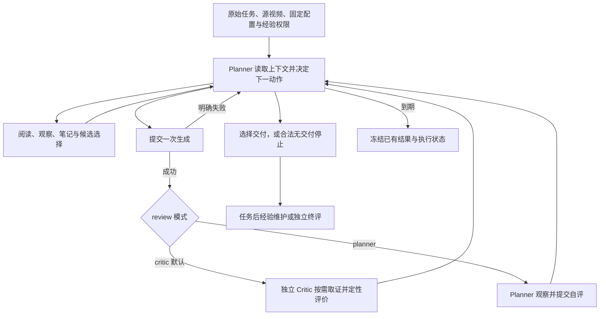

# 当前 Loop 设计与实现

本页定义当前开发代码的运行主线。主实验安排见 [experiment-campaign.md](experiment-campaign.md)，参数见 [配置说明](benchmark-guide/configuration.md)，实际验证状态见 [current-status.md](current-status.md)。

## 一条任务怎样执行

生成成功后每轮都检查，包括最后一轮。Critic 获得原始任务、Planner 提交与实际生效的生成提示词、关注重点、原片、实际输入、候选及参考；它按需请求概览、原生连续帧、分页或裁剪，给出评价和证据。在线检查不使用正式终评分数或评分手册，也不提供下一步编辑建议。

Planner 自评与 Critic 共享观察能力。Planner 可先阅读、补看和记笔记，再将 `review: {video_id, summary, findings?}` 与下一动作一起提交。检查和动作按实际有效性更新状态；失败动作不应留下半次更新。

`finish` 复用已做的检查，由 Planner 选择候选，不再启动末尾评审或要求第二次确认。明确的 Critic 失败作为工具结果返回，Planner 可以继续、交付已有候选或停止。超时优先保留 Planner 已指定候选；未指定时保留明确标记的最新成功生成 fallback，不伪造检查完成或最终确认。

## 资源与终止

Each sample × prompt form × method × seed is a separate task. Current experiments require using the configured generation allowance (default N=4) before final selection. The Planner controls each input and prompt and can select an earlier candidate. Submitted generation attempts count, including execution failures; recovering the same request does not count again. The submission deadline is the renderer estimate multiplied by N+0.5, using 1200 seconds per Bernini generation and 2400 seconds per Ditto generation. After N, observation, reading and delivery remain available within the remaining task time. Technical interruption remains an interrupted outcome.

模型调用、token、费用和执行状态继续记录。默认在线路径以生成次数和任务期限为边界；Planner 看到模糊阶段提示和是否还能生成。任务后维护单独配置，不消耗在线生成预算。独立 GLM／Sonnet 评分不设置人为调用、token 或费用上限。

到期、明确失败、合法无交付停止和正常交付都能结算。已提交但结果未知的请求沿原 job 核实恢复，不将其伪装成失败后再次提交。未知模型调用隔离所属任务；未知 GPU 执行保留设备占用，避免重复渲染。

## 模块职责

| 层 | 主要模块 | 职责 |
|---|---|---|
| 状态机 | `planner_harness.runner`、`creative_actions` | 准备上下文、解释动作、保存状态和事件 |
| 每轮检查 | `automatic_review`、`critic_harness.qualitative` | 生成后的检查、反馈与继续决策 |
| 观察与记忆 | `video`、`event_observation`、`context`、`working_memory` | 原生时间证据、分页、工作记录与上下文 |
| 交付 | `candidate_selection`、`delivery`、`delivery_review` | 候选选择、停止和最终结果 |
| 执行与恢复 | `execution`、`model_call`、`recovery`、`accounting` | 请求与回执、已知失败、未知执行和恢复 |
| 服务 | `server_runtime` | 持久队列、每设备渲染和跨任务流水线 |
| 实验 | `experiments.campaign`、`unified_benchmark`、`results` | 方法条件、经验版本、登记、评分与汇总 |
| API | `vlm.settings`、`vlm.openrouter` | 统一角色解析和真实请求传输 |
| 终评 | `evaluation.providers`、`validation`、`low_high`、`final_suite` | 独立判官配置、正式评分和统计 |

`critic_harness.one_shot` 保留历史导入兼容；正式数值评分校验由 `evaluation.validation` 维护。旧 RSI／legacy 实现在 `planner_harness.compat`，不扩展当前动作协议。历史直连判官在 `evaluation.legacy_providers`，当前默认工厂统一走 OpenRouter。

## 数据与经验

主实验按全量运行，RSI 划分只控制无经验组中哪些任务结束后维护经验，以及 RSI 汇总的子集；当前方案为 40／27。前段 none 结算后开放维护 Skill 和累计私有经验；后段 none 只运行、不维护。冻结后 full 运行全量，在线只读该版本。四组共享同一结果入口，数量和 PE／Planner 各自 N 见 [运行安排](experiment-campaign.md)。无新增经验是一种正常维护结果。

Direct、PE、Planner-once、Best-of-N 和不同 loop 保留各自实际输入、提示词、seed、生成收据及候选谱系。跨 review 模式复用符合条件的 Direct 视频；不同方法／模式的结果身份不能互相覆盖。正式终评只读取原始任务与终评证据。

## 修改和检查

对主线修改，运行 `python scripts/check_repository.py --suite current`；对历史兼容修改，另跑对应历史模块。测试使用合成视频和脚本化／mock API，不把它们记作真实模型效果。新增入口应复用角色配置、生成执行和结果注册接口，避免再复制一套循环。

运行中的任务继续使用既有配置与回执。实现或协议变更在新的运行目录中验证；已有媒体和冻结交接包保持可追溯。实测 API 地区限制是外部运行条件，见当前状态页。
