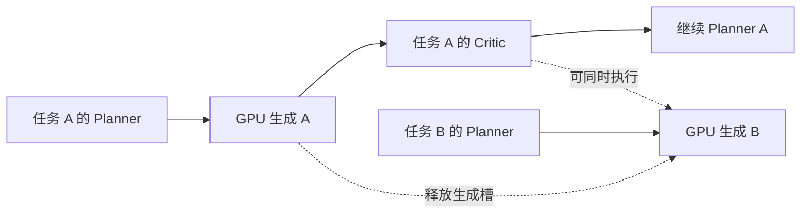

# 持久化队列与进程管理

本版本为后续 5090 上的 agent loop 验证准备代码。当前 H800 已排定批次沿原 launcher 收尾，用户随后释放实例；服务器迁移延后。新服务没有部署或接管现有进程，也没有启动 loop 正式评测。`enable_final_evaluation` 默认关闭，示例任务仅配置在线 Critic。

## 执行语义与并发

`scripts/run_server_pipeline.py` 在现有 PlannerHarness 外安排资源。Planner 仍决定何时生成、调用 Critic、使用哪个候选作为输入、修改什么提示词及选择哪个结果。每个任务的依赖链按这些实际决定展开。预算、原始要求、生成设置、seed、输入视频、签名及完整反馈保留；不强制固定迭代路线。



默认共享两个 LLM 槽、一个 GPU 槽、两个 CPU 槽。Planner、在线 Critic、在线评价与将来启用的正式 judge 共用 LLM 上限。每个槽中的 harness 调用保持顺序；跨任务形成流水线。每张 GPU 每个服务串行生成，Bernini 模型复用常驻实例。GPU 与外部 LLM 推理可以重叠。正式 judge 如将来启用，其 CPU 证据准备也可重叠。解码缓存按视频内容 SHA 复用原始像素及 PTS，保留全部连续帧，内存上限默认 512 MiB。

Planner/Critic 只在建立知识快照的短暂阶段共用发布锁，最多等待 60 秒；模型调用不持有该锁。运行目录的所有者锁仍然立即拒绝第二个进程。此调整解决了多个任务同时开始时的快照锁冲突。

这是单主机服务：SQLite WAL 必须位于本地磁盘，不能放在 WSL UNC、NFS 或多主机共享挂载上。一个服务目录由一个进程持有 OS 锁；同 GPU 的服务须采用相同 `gpu_lock`。旧 launcher 不使用此锁，因此未来启动时要先确认对应旧进程已经退出。多个服务器的 LLM 槽位需静态分配，例如各 1 个合计 2 个；本实现没有跨主机全局限流器。

## 状态、停止与恢复

- 数据库保存任务依赖、签名、资源、优先级、各次尝试、所有者与时间。相同幂等键及输入复用任务，改变输入则拒绝。最终评价优先级较低，并随等待时间提高，减少长时间饥饿。
- `run --once` 完成当前可执行依赖链后退出。依赖失败时留下阻塞状态，不宣称全部完成。`run` 常驻等待新任务；工作完成事件立即唤醒调度，外部入队至多约 1 秒被扫描到。
- `drain` 持久化停止派发。已经开始的调用完整结束，模型释放，进程退出；后续依赖可以登记，但保持排队。SIGINT/SIGTERM 使用同样机制。`resume` 只恢复派发许可，随后需再次执行 `run`。没有自动 kill、容器关机或释放实例的动作。
- `status` 显示依赖阻塞、尝试历史及错误；`status.json` 是运行快照，`stopped.json` 记录本次所有者、退出原因与任务计数。判定活跃进程需同时核对 PID/所有者与 OS 锁，旧 JSON 不是存活证明。
- 进程中断后，有完整回执且文件哈希匹配的结果直接登记；已有签名工具 response 也可收回，不重新生成。外部调用已开始但没有完整回执时进入 `needs_review`，独立任务继续。检查日志与产物后，操作员可用 `retry --job ID --reason ...` 允许再尝试，理由留在尝试记录中。确定性证据准备允许恢复重做。
- 这保证对完整回执的复用；它不能保证远端 LLM 已处理但本机未收到回答时的 exactly-once。该情况明确保留为不确定，不自动追加模型调用。

服务配置及运行代码/手册的哈希在初始化时固定，执行前复核。修改代码后用新的服务目录或冻结 checkout，不热更新在跑的任务。Planner 仍按自身机制冻结每个任务的知识快照。不同新任务使用的知识版本应在实验入组前统一冻结；不要在实验期间修改该 checkout。

## 后续 5090 验证时的入口

以下是操作入口，本次没有在服务器执行。使用已经验证的 Bernini Python 环境；控制器依赖为 `requirements.server-runtime.txt`，该文件不安装 torch/CUDA。环境、订阅登录或 API 后端、GPU 和素材路径须先在目标机器验证；本工具不会搬运认证或启动付费实例。

1. 复制 `examples/server-runtime/bernini-service.json` 到本次运行配置。用现有部署记录中的真实模型 revision 固定安装资产：

   ```bash
   python scripts/deploy/pin_bernini_runtime.py \
     --model-revision ACTUAL_DEPLOYMENT_REVISION \
     --output out/server-assets/bernini.json
   ```

   将输出的 SHA 填入服务配置的 `asset_manifest_sha256`。该命令对现有模型及 Python 源码做流式哈希；不下载、不加载 GPU。revision 字段记录操作员提供的部署出处，实际字节哈希才是本机核对依据。首次加载模型时重新验证完整资产。

2. 在本地磁盘建立独立服务，按需要修改示例任务的 ID/预算，保持实验已批准设置：

   ```bash
   python scripts/run_server_pipeline.py --service /persistent/lha-service init --config bernini-service.json
   python scripts/run_server_pipeline.py --service /persistent/lha-service submit --manifest examples/server-runtime/041-task.json
   python scripts/run_server_pipeline.py --service /persistent/lha-service run --once
   ```

3. 状态查询和在当前调用完成后停机：

   ```bash
   python scripts/run_server_pipeline.py --service /persistent/lha-service status
   python scripts/run_server_pipeline.py --service /persistent/lha-service drain
   # 之后明确继续这批排队任务时：
   python scripts/run_server_pipeline.py --service /persistent/lha-service resume
   python scripts/run_server_pipeline.py --service /persistent/lha-service run --once
   ```

原生视频保存 101 帧/20 FPS（5.05 秒），迭代输入继续使用完整原生帧；乒乓球按相应协议设置 133 帧/30 FPS。不会通过裁剪或补帧加速。模型内部官方 system prompt 和清洗后的编码文本单独记录，提交给 pipeline 的原始英文提示词不变。token 超限明确报错。

本阶段常驻适配器仅支持 Bernini；Ditto 保留现有批次运行器，不新增 H800 服务。模型调用沿用 GPT-6.1-sol/xhigh，CLI 单次超时默认 1800 秒，服务将隐式传输重试次数设为 1，以保留不确定失败。环境变量中的 role 专属模型覆盖若改变模型或 effort，服务会报错。

## 正式评价接口（当前关闭）

未来独立启用评价的服务可设置 `enable_final_evaluation: true`，用 `evaluate --manifest cases.json` 提交已有视频，字段为 `case_id/method/seed/card/output_video/output_sha256`，可附逐帧 `mapping` 与固定 `references`。任务卡、映射和参照清单在入队时冻结，媒体和参照图片在使用时验哈希。最终 judge 使用独立上下文，只看原始任务、源视频与输出证据；方法名、生成提示词和在线 Critic 不进入最终打分。输出沿原评价协议保留小数、未知和分项指标。

Loop 任务也预留可选 `final_evaluation` 字段（`card`、`references`、`all_generated`），运行时只在 Planner 完成后另行入队，默认评全部生成候选及所选结果。该字段在当前默认配置中会被拒绝。本次没有创建任何实际 loop 正式评价任务。

## 验证范围

`python scripts/test_server_runtime.py` 使用合成视频与脚本化模型，检验真实 PlannerHarness 的生成→Critic→继续生成→选择流程、依赖和预算、跨资源并发、GPU 串行、进程互斥、持久化停止、完整回执恢复、哈希篡改拒绝、不确定调用显式重试、队列展开中断恢复，以及缓存前后图像/PTS 一致和独立 judge 信息隔离。Bernini 适配器的单元测试检查常驻对象复用和参数传递。

这些测试验证调度及接口正确性。真实 5090 上的环境、模型加载、订阅/API 接入、长时运行以及并发带来的实际耗时变化，留到下一轮运行验证；不把离线测试计作实验样本或模型效果证据。

2026-10-30 本地验证：新增运行服务测试 18 项通过；原评价 32 项、worker 6 项、continuous planner 6 项、Critic/Planner 联合回归 22 项通过，共 84 项。并行测试最初暴露的快照锁冲突已修复，随后并行重跑通过。测试使用 Windows Python 3.12、PyAV 19.0.2 和 OpenCV 4.13.0；服务状态落在主机临时本地磁盘，实际视频生成调用均由明确的合成夹具替代。
