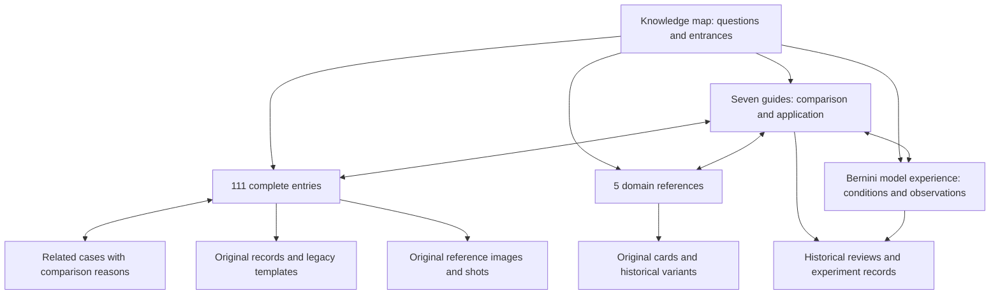

# LHA knowledge map

## Current reading entrances

Use the [creative-loop map](creative-loop/README.md) and [reading manual](creative-loop/READING.md) for the active Planner profile. The full source catalog below contains **111 complete entries, five domain references, seven guides and one model-experience record**.

- **Understand and design:** the [professional manual](creative-loop/UNDERSTAND_AND_DESIGN.md) and [meaning guide](guides/meaning.md) connect the requested change to activities, object roles and narrative emphasis.
- **Visual construction:** [theme](guides/theme.md), [media](guides/media.md), [time](guides/time.md), [combination](guides/combination.md) and [design expression](guides/design-expression.md) help choose and develop a coherent proposal.
- **Understand and revise:** the [professional manual](creative-loop/UNDERSTAND_AND_REVISE.md) and [experience entrance](experience/curated/README.md) connect observed results to comparison and revision. Approved curated experience is currently empty; its rewritten content awaits activation review.
- **Trace a claim:** complete entries link original designs and references; [generation history](guides/experience.md) and the [Bernini probe](model-experience/bernini-r.md) retain the conditions behind observed outcomes.

The working language is English. Editorial guidance and translations identify their sources; original-language records remain available for provenance. Task exploration follows the unresolved question. The full catalog is an inventory, while the guides explain useful differences and reading paths.

The current runtime is documented in [creative-loop implementation](../docs/creative-loop-implementation.md). It keeps the Planner in charge of the proposal, tools and delivery, with an optional one-shot structured Critic. Knowledge maintenance is separately requested work. Legacy Wiki and RSI assets remain historical and are outside this profile's reading scope.

[Source map](source-map.json) · [Original corpus validation](VALIDATION.md) · [Current editorial alignment](../docs/knowledge-guidance-alignment-20261101.md)

## Enter through a relationship you want to understand

| Guide | What it actually discusses | Questions for deeper reading |
|---|---|---|
| [Video meaning and design possibilities](guides/meaning.md) | Actions and withheld actions, relationships, object roles, viewing position, information order, and design possibilities opened by a request | What happens in the segment? How would an appearance change affect its meaning? |
| [Subject matter and visual language](guides/theme.md) | Why technical drawings, typewriters, fabric, or court painting relate to a subject; different interpretations of related subjects | Why use this form for this subject? What relationship could support another direction? |
| [How different media form an image](guides/media.md) | Transparency and coverage, cut marks and printed color, stained glass and mosaic, silent film and DV, three-dimensional space and animation rhythm | What forms the image? How would another medium affect form, light, and movement? |
| [Composition, light, and time](guides/time.md) | Gradual spatial revelation, change within stability, sustained actions, daylight transitions, and editing through a medium | What does the viewer see, and when? How do camera, light, and events support one another? |
| [Combining styles and methods](guides/combination.md) | Transforming the same subject, nested spaces, alternating viewpoints, and combinations within a visual language | What does each component contribute? What connects them? Where does difference carry meaning? |
| [From knowledge to a visual proposal](guides/design-expression.md) | Two authored walkthroughs from benchmark requests through source reading, design choices, and English style expression | How does a visual relationship become part of a new proposal? |
| [What earlier generation experiments teach](guides/experience.md) | Earlier Planners, domain cards, compilation paths, semantic drift, conflicting instructions, truncation, implicit inputs, and evaluation limits | Under what conditions does an observation apply? Which part of the process could a change improve? |

These entrances connect across topics. The Last Emperor participates in discussions of subject, medium, and combination; Titanic participates in combination and temporal organization. Complete cases preserve their meaning, while guides supply reasons to take particular reading paths.

## Working reading chains

**Start with combination:** the [combination guide](guides/combination.md) explains transformation between expressions of the same subject → [070 Titanic](entries/opuscar-070.md) provides the complete blueprint, developing image, three-dimensional ship, camera movement, and day-to-night design → [030 The Bridge on the River Kwai](entries/opuscar-030.md) shows events that stay within a blueprint. Both entries link to the [original record collection](../zyx/styles.json), selected by `no=70` and `no=30`, and their respective legacy templates.

**Start with meaning:** the [meaning guide](guides/meaning.md) discusses action and withheld action → [051 The Deer Hunter](entries/opuscar-051.md) connects lowering a gun with tempera and open composition → [048 One Flew Over the Cuckoo's Nest](entries/opuscar-048.md) contrasts the rupture of a quiet interior through violent action. Understanding develops from complete events and their presentation.

**Start with why a subject uses a form:** the [subject guide](guides/theme.md) discusses social occasions and visual expression → [060 The Last Emperor](entries/opuscar-060.md) connects meticulous painting, ruled architecture, and ceremony → [039 Formal portrait](entries/opuscar-039.md) and [071 Private miniature and theater](entries/opuscar-071.md) offer comparisons. The [Chinese-period domain reference](domain-references/chinese_period.md) provides a further comparison between terminology cards and complete designs.

**Start with an actual style task:** [From knowledge to a proposal](guides/design-expression.md) follows benchmark 041 through [053 watercolor](entries/opuscar-053.md) and [063 pencil and wash](entries/opuscar-063.md), then separates the selected design from a new draft prompt. The table-tennis walkthrough adapts technical materials and local lighting to a specified space-station arena. Both connect to the [Bernini-R experience record](model-experience/bernini-r.md), which links all ten actual inputs, outputs, and reviews. These are authored illustrations of knowledge use, with new wording explicitly identified as untested.

## Layers and depth

An OPUSCAR page provides editorial reading, design relationships, motivated cross-links, the original reference image, complete original English descriptions and prompts, all shots in their original order, direction notes, reference statements, metadata, and full legacy-template data. Folded blocks remain fully present in the Markdown file. Stable IDs such as `opuscar-070` correspond to original record numbers.

Base-template pages contain complete English reading editions and explain world assumptions, connections, and knowledge gaps. Seven templates require translation of Chinese values; those fields and their provenance are recorded in the manifest. Domain pages retain specialist material and the original base, `decisive`, and `execution_only` card outputs, making the context of each restriction or expansion inspectable. The seven guides contain curatorial synthesis and design-application examples, with routes back to cases and historical records. The model-experience record connects conditional findings to run settings, actual inputs, videos, and judgments.

## Coverage and source conditions

The 98 OPUSCAR records connect subjects, visual language, motion, and shots in substantial detail. Their production account describes code and three-dimensional rendering, with implementation conditions different from video models such as Bernini. Recurring Clawd characters, orange identification colors, color values, durations, and transitions belong to the original anthology. Readers can develop new proposals from these relationships; later execution will test generation outcomes.

The 13 base templates focus on animation, historical fantasy, and science fiction. Several are brief. The 5 domain cards offer local terminology and editing experience, with substantial variation within some domains. The corpus supports broad exploration and comparison; new combinations may still require model inference or additional sources. Artistic references and historical measurements retain their source status. This pass did not externally verify every art reference or remeasure experimental results.

The complete catalog below is organized by provenance for inventory and direct access. Task exploration can start from any entry, guide, or question.

## Base templates

| Material | Reading orientation |
|---|---|
| [Alien biomechanics: a shared logic for organic and artificial structures](entries/base-alien_biomech.md) | Living walls, membranes, pulsing light, and biomechanical metal form a whole-world proposal with extensive strategy annotations. |
| [Clean laboratory: a controlled technological setting](entries/base-clean_lab.md) | Polished structures, orderly layouts, panel lighting, and research roles form the original futuristic laboratory. |
| [Cyberpunk anime: urban setting and graphic characters](entries/base-cyberpunk_anime.md) | A basic proposal combining neon urbanism, technical clothing, and animation, useful for distinguishing world setting from representation. |
| [Cyberpunk dystopia: the original dense-city direction](entries/base-cyberpunk_dystopia.md) | Neon, wet surfaces, devices, and street clothing are situated within a crowded dystopian city. |
| [Fantasy anime: image layers and epic character setting](entries/base-fantasy_anime.md) | A basic fantasy proposal built through legible silhouettes, illustrated depth, and magical light. |
| [Industrial wasteland: power systems, wear, and survival roles](entries/base-industrial_wasteland.md) | Corroded structures, power equipment, and heat-damaged surfaces organize a harsh industrial world. |
| [Post-apocalyptic wasteland: salvaged machinery and mobile survival](entries/base-mad_max_wasteland.md) | War vehicles, fuel, protective gear, and dust establish an aggressive post-apocalyptic direction. |
| [Medieval fantasy: material, heraldry, and an inhabited world](entries/base-medieval_fantasy.md) | Stone construction, banners, layered clothing, and worn surfaces organize a fantasy setting grounded in historical materials. |
| [Galactic adventure: used-future equipment and heroic travel](entries/base-star_wars_scifi.md) | Worn technology, robes or uniforms, staged spaces, and travelers form this space-opera reference. |
| [Soft painterly animation: the original Ghibli direction](entries/base-studio_ghibli.md) | The original template selects painted backgrounds, soft light, and natural atmosphere, emphasizing coherence between characters and surroundings. |
| [Wormhole portal: science fiction organized around a spatial event](entries/base-wormhole_portal.md) | A ring device, event-driven light, and participants organize a proposed portal-opening scene. |
| [Wuxia: action, historical materials, and poetic space](entries/base-wuxia.md) | A martial-arts film direction built around heroic figures, flowing cloth, and layered landscapes. |
| [Xianxia: the original card's spiritual and ceremonial direction](entries/base-xianxia.md) | Sacred space, layered robes, soft radiance, and ceremony form one particular xianxia proposal. |

## Domain references

| Material | Reading orientation |
|---|---|
| [Chinese period settings: vocabulary, visible evidence, and historical card scope](domain-references/chinese_period.md) | The original card supplies terms for headwear, clothing, sets, and light sources, while recording visible-region restrictions and their trade-offs. |
| [Western period and fantasy settings: specific materials and open world assumptions](domain-references/western_period_fantasy.md) | Wool, linen, brocade, timber, stone, and practical lights provide one setting direction within a broad range of historical and fantasy possibilities. |
| [Science fiction and modern styling: technical vocabulary and world assumptions](domain-references/sci_fi_modern.md) | Technical garments, panels, cables, and accessories offer local vocabulary; cyberpunk, clean laboratories, and biomechanical worlds have different organizing ideas. |
| [Whole-image appearance: the historical filter card and complete medium design](domain-references/style_filter.md) | The original card describes style transfer through grading and texture; complete cases develop image construction, viewing apparatus, and motion. |
| [Nature and landscape: space, light, and human experience](domain-references/nature_landscape.md) | The original card organizes sky, vegetation, distance, and aerial perspective; other cases add different times and viewing relationships. |

## Complete OPUSCAR cases

| Material | Reading orientation |
|---|---|
| [001 \| Wings: Silent-era 3D Dogfight, Tinted Ortho B&W](entries/opuscar-001.md) | Aircraft-mounted viewpoints, orthochromatic grading, and projection wear work together to present a silent-era dogfight. |
| [002 \| The Broadway Melody: Black-Gold Art Deco Revue Poster](entries/opuscar-002.md) | An Art Deco musical poster turns the arrival of sound cinema into moving graphic design through microphone waves, bulbs, and chorus formations. |
| [003 \| All Quiet on the Western Front: Kollwitz Anti-war Woodcut](entries/opuscar-003.md) | An anti-war woodcut combines black-and-white cuts, figure scale, and quiet action to organize a view of grief. |
| [004 \| Cimarron: 1889 Sepia Albumen Panorama](entries/opuscar-004.md) | An 1880s print appearance, hand coloring, and a widening panorama connect an individual rider to the scale of a land rush. |
| [005 \| Grand Hotel: MGM Silver B&W 3D Lobby](entries/opuscar-005.md) | A 3D lobby is built around a concentric overhead composition, then experienced differently through a figure-height tracking shot. |
| [006 \| Cavalcade: Mucha Art Nouveau Panel](entries/opuscar-006.md) | An Art Nouveau halo becomes a New Year's clock face, making decorative structure participate in a story moment. |
| [007 \| It Happened One Night: 1930s B&W Rubber-hose Cartoon](entries/opuscar-007.md) | A road comedy becomes rubber-hose animation, with distinct character and background treatments and comic timing carried by motion. |
| [008 \| Mutiny on the Bounty: Admiralty Sea Chart Copperplate](entries/opuscar-008.md) | A voyage stays on a nautical chart, connecting mapped routes and shipboard events within one continuous shot. |
| [009 \| The Great Ziegfeld: Silver B&W 3D Wedding-cake Stage](entries/opuscar-009.md) | A spiral stage, material reflections, and a rising camera jointly reveal the scale of a musical spectacle. |
| [010 \| The Life of Emile Zola: Newsprint Letterpress and Line Engraving](entries/opuscar-010.md) | The newspaper is both image material and a means of circulation: a headline, public speech, and a printing press form one sequence. |
| [011 \| You Can't Take It with You: WPA Silkscreen Poster](entries/opuscar-011.md) | A WPA screenprint explains flat imagery through ink coverage and separation order, while family activity and fireworks establish time. |
| [012 \| Gone with the Wind: Technicolor Impasto Oil](entries/opuscar-012.md) | Impasto, Technicolor color, and epic viewing scales connect a personal vow to large historical scenes. |
| [013 \| Rebecca: Gothic Charcoal Drawing](entries/opuscar-013.md) | Charcoal tone, erasure, and smudging produce a dream manor, fog, and fire, while repeated inward moves tighten the view. |
| [014 \| How Green Was My Valley: Welsh Valley Gouache](entries/opuscar-014.md) | Welsh-valley gouache connects landscape painting, mining space, and collective walking, and records why the author changed medium. |
| [015 \| Mrs. Miniver: Home Front Stone Lithograph](entries/opuscar-015.md) | Wartime lithographic separations and a woman's upward glance connect a church, its congregation, and aircraft overhead. |
| [016 \| Casablanca: Studio Glamour Black-and-White](entries/opuscar-016.md) | Studio-monochrome facial modeling and two long camera moves connect relationships in a cafe with a farewell in fog. |
| [017 \| Going My Way: Backlit Gothic Stained Glass](entries/opuscar-017.md) | A stained-glass window contains a performance and projects color into its surroundings, connecting image space with the viewing environment. |
| [018 \| The Lost Weekend: Typewriter Character Art](entries/opuscar-018.md) | The story's typewriter becomes the image-making medium, with character density shaping both the street and its mood. |
| [019 \| The Best Years of Our Lives: Picture-Magazine Halftone Spread](entries/opuscar-019.md) | A deep-focus aircraft graveyard is gradually revealed as a magazine spread, joining spatial immersion with the discovery of its medium. |
| [020 \| Gentleman's Agreement: 1940s Graphite Magazine Illustration](entries/opuscar-020.md) | Magazine pencil illustration connects the drawing process to character reactions, with conflict developing through expressions and glances. |
| [021 \| Hamlet: Deep-Focus Fog Castle, 3D B&W](entries/opuscar-021.md) | A 3D castle, fog, and waves create a dark space through value and depth, then acquire meaning through a ghost and a soliloquy. |
| [022 \| All the King's Men: Wood-Type Campaign Poster](entries/opuscar-022.md) | A campaign poster organizes political performance through wood type, a portrait, and a crowd's response. |
| [023 \| All About Eve: Hirschfeld One-Line Caricature](entries/opuscar-023.md) | Theater caricature uses continuous-looking lines, figure proportions, and dialogue in open space to organize a party's relationships. |
| [024 \| An American in Paris: Dufy Watercolour Ballet](entries/opuscar-024.md) | Deliberately offset line and color move with the dance, connecting watercolor language to ballet design. |
| [025 \| The Greatest Show on Earth: Strobridge Circus Lithograph](entries/opuscar-025.md) | A circus poster's radiating perspective and simultaneous actions become a sequence of searching, procession, and a climactic catch. |
| [026 \| From Here to Eternity: High-Key Beach Black-and-White](entries/opuscar-026.md) | A high-key monochrome beach supports action through layers of water, sand, and light, offering a distinct value structure. |
| [027 \| On the Waterfront: Ben Shahn Social Realism](entries/opuscar-027.md) | Social-realist drawing and the juxtaposition of dock and rooftop jointly portray the character's situation. |
| [028 \| Marty: 1955 Kinescope on a Living-Room TV](entries/opuscar-028.md) | A viewer enters a television program from a living room; screen artifacts and an invitation to dance organize the nested experience. |
| [029 \| Around the World in 80 Days: 1950s UPA Modernist Cartoon](entries/opuscar-029.md) | Limited animation compresses travel into maps, landscapes, and character gags, using geometric forms and shallow parallax for rapid changes of place. |
| [030 \| The Bridge on the River Kwai: Cyanotype Engineering Blueprint](entries/opuscar-030.md) | An engineering drawing carries the bridge story, while red-pencil annotation becomes the language of explosion and action. |
| [031 \| Gigi: Lautrec Belle Époque Lithograph](entries/opuscar-031.md) | Belle Epoque lithography organizes social attention in a restaurant through lateral viewing, with caricature and print marks supporting each other. |
| [032 \| Ben-Hur: 3D Circus Chariot Race, 65mm Epic](entries/opuscar-032.md) | Multiple viewpoints within continuous 3D chariot racing connect spectacle at scale with local collisions. |
| [033 \| The Apartment: Saul Bass Line Titles in Black & White](entries/opuscar-033.md) | Title lines generate office space, which an overhead view then reads as a pattern; a figure and key become the focus. |
| [034 \| West Side Story: Technicolor 3D Stage Set](entries/opuscar-034.md) | A musical street retains theatrical color within 3D space, while finger snaps, jumps, and matching cuts establish rhythm. |
| [035 \| Lawrence of Arabia: Terpning Epic Poster Gouache](entries/opuscar-035.md) | Poster gouache uses warm-cool contrast, diagonal action, and desert scale for an epic subject, entered through a graphic match. |
| [036 \| Tom Jones: Hand-Coloured Georgian Satirical Print](entries/opuscar-036.md) | Satirical engraving combines line work, hand washes, dialogue, and performance within a shared comic tone. |
| [037 \| My Fair Lady: Bob Peak Fashion Illustration](entries/opuscar-037.md) | Fashion illustration uses fast ink, pools of color, and a lateral figure arrangement to depict a social occasion; hats and binoculars also carry transitions. |
| [038 \| The Sound of Music: Storybook 3D Alpine Aerial](entries/opuscar-038.md) | A storybook-like 3D landscape narrows from aerial scale to a spinning figure, with terrain, wind, and movement curves creating flow. |
| [039 \| A Man for All Seasons: Holbein Tudor Portrait in Oils](entries/opuscar-039.md) | Detailed material handling and restrained action establish a formal portrait before a pullback places it in a room. |
| [040 \| In the Heat of the Night: Three-Ink Risograph Night](entries/opuscar-040.md) | Three-color printing represents light as unprinted paper, while crossing flashlight beams and reactions create confrontation. |
| [041 \| Oliver!: Victorian Toy Theatre](entries/opuscar-041.md) | A paper theater exposes its manipulation and viewing apparatus while preserving a complete dramatic exchange within the cardboard space. |
| [042 \| Midnight Cowboy: Warhol Photo-Silkscreen, Double Elvis](entries/opuscar-042.md) | Street action becomes a repeated photographic screenprint image, making the composition itself undergo a change of meaning. |
| [043 \| Patton: WWII War-Bond Lithograph](entries/opuscar-043.md) | The graphic scale of a war-bond poster relates a speaker to an enormous flag; a final pullback reveals the performance venue. |
| [044 \| The French Connection: 16mm Chase Under the El](entries/opuscar-044.md) | Camera placement, repeated columns, and spatial motion create the speed of a 3D car chase, while a 16mm appearance adds a documentary tone. |
| [045 \| The Godfather: Rembrandt Top-Light Oil Painting](entries/opuscar-045.md) | Top light, glazing, and slow gestures establish power within a study; the ending introduces a poster-like metaphor. |
| [046 \| The Sting: Saturday Evening Post Illustration](entries/opuscar-046.md) | A magazine-illustration betting room narrows through one approach to a secret signal, bringing the viewer into the exchange when the figure looks at the camera. |
| [047 \| The Godfather Part II: Hand-Tinted Sepia Photograph](entries/opuscar-047.md) | A hand-colored photograph connects an immigrant crowd, a subjective view, and a name tag, expressing arrival through small gestures. |
| [048 \| One Flew Over the Cuckoo's Nest: Hopper-Style American Realism](entries/opuscar-048.md) | A sudden forceful act breaks a still, divided interior; painting and temporal contrast jointly shape the adaptation. |
| [049 \| Rocky: Philadelphia Sunrise, 3D on 35mm](entries/opuscar-049.md) | Rapid training cuts become a continuous climb and orbit, revealing the sunrise city as the action reaches completion. |
| [050 \| Annie Hall: New Yorker Cartoon, Ink and Wash](entries/opuscar-050.md) | A single-panel cartoon's washes, caption, and everyday props become a timed gag, followed by a split-screen comparison of families. |
| [051 \| The Deer Hunter: Andrew Wyeth Egg Tempera](entries/opuscar-051.md) | Fine dry-brush tempera and an open composition accompany a shot that is never fired; action and gaze reveal a decision. |
| [052 \| Kramer vs. Kramer: Child's Wax-Crayon Drawing](entries/opuscar-052.md) | A child's crayon drawing supplies a viewpoint on family life, with the same pan connecting stages of a changing relationship. |
| [053 \| Ordinary People: Autumn Transparent Watercolour](entries/opuscar-053.md) | Reserved paper, transparent glazes, and an autumn setting carry a character's gaze and an unanswered relationship. |
| [054 \| Chariots of Fire: 1924 Paris Olympics Stone Lithograph](entries/opuscar-054.md) | An athletic scene gradually becomes an Olympic poster, with print grain, figure construction, and slowed details expressing running. |
| [055 \| Gandhi: Rajasthani Hand Block Print](entries/opuscar-055.md) | The significance of homespun cloth becomes the material of the whole image, keeping procession, salt, and spinning wheel within one logic. |
| [056 \| Terms of Endearment: Family Album Polaroids](entries/opuscar-056.md) | A faded album photograph comes alive; restored color and movement turn an image of the past into a present scene. |
| [057 \| Amadeus: Rococo Silhouettes in Gilt Candlelight](entries/opuscar-057.md) | Silhouettes, an opera house, and a watcher in darkness give one performance viewpoints on and off the stage. |
| [058 \| Out of Africa: 3D Biplane over the Rift Valley](entries/opuscar-058.md) | Aerial space finally narrows to a handshake in the cockpit, connecting landscape scale to a relationship through camera position. |
| [059 \| Platoon: Combat Artist Field Sketch · Pen & Wash](entries/opuscar-059.md) | Pen-and-wash field recording combines ground and aerial views into a war fragment centered on infantry experience. |
| [060 \| The Last Emperor: Gongbi Court Painting on Silk](entries/opuscar-060.md) | Gongbi painting, ruled architecture, and ceremony explain one another, connecting paint layers to figures, palace space, and shots. |
| [061 \| Rain Man: 80s Airbrush + Raymond's Count](entries/opuscar-061.md) | Airbrush illustration and counting annotations share an image, with the annotation layer expressing how a character understands the world. |
| [062 \| Driving Miss Daisy: Rockwell-style Oil Illustration](entries/opuscar-062.md) | Views inside and outside an oil-illustrated car narrow to its rear-view mirror, ending on a small change of expression. |
| [063 \| Dances with Wolves: Field Journal · Pencil & Watercolour](entries/opuscar-063.md) | Drawing a journal becomes a route into the prairie, where a relationship with a wolf develops through the recorder's viewpoint. |
| [064 \| The Silence of the Lambs: Hand-coloured Natural-history Copperplate](entries/opuscar-064.md) | Natural-history numbering and engraving extend into figures and a cell, turning specimen observation into confrontation. |
| [065 \| Unforgiven: Remington Western Oil · Sunset & Nocturne](entries/opuscar-065.md) | One oil-painting method accommodates sunset and rainy night, allowing time to change the relationship between light and the figure. |
| [066 \| Schindler's List: Black-and-white Film, One Red Coat](entries/opuscar-066.md) | Selective color gains its role through gaze and narrative change; candlelight at the end reinterprets the monochrome arrangement. |
| [067 \| Forrest Gump: Sabuda Pop-up Book on a Real Desk](entries/opuscar-067.md) | Physical page turns perform the editing in a pop-up book, giving several life episodes one visible storytelling apparatus. |
| [068 \| Braveheart: Illuminated Manuscript with Gold Leaf](entries/opuscar-068.md) | An illuminated page combines writing, an initial, battle imagery, and gold leaf; the view passes from letterform into event. |
| [069 \| The English Patient: Explorer's Scrapbook Watercolour](entries/opuscar-069.md) | A scrapbook retains overlapping materials; entering one painting turns a remembered image into an accessible cave. |
| [070 \| Titanic: Blueprint Developing into 3D Sunset](entries/opuscar-070.md) | The same ship passes from engineering drawing into a 3D world; camera motion, development, and day-night change form a continuous process. |
| [071 \| Shakespeare in Love: Hilliard Elizabethan Miniature](entries/opuscar-071.md) | A portrait miniature extends from a private pendant to a public theater, retaining its painting method while changing the occasion of viewing. |
| [072 \| American Beauty: Suburban Symmetry + DV Camcorder](entries/opuscar-072.md) | Clean suburban cinema alternates with low-resolution DV, giving the two imaging methods different viewing and psychological contexts. |
| [073 \| Gladiator: Roman Floor Mosaic](entries/opuscar-073.md) | Mosaic tesserae follow forms, while gestures and scene changes carry events and imagery. |
| [074 \| A Beautiful Mind: Window Marker & Chalk, Gold Pattern](entries/opuscar-074.md) | Handwritten symbols and golden connections express the discovery of patterns, adding a cognitive role to ordinary writing surfaces. |
| [075 \| Chicago: Fosse Stage in Red and Black](entries/opuscar-075.md) | Stage compartments light up in sequence, and silhouettes with individual spotlights narrow an ensemble performance toward its principal figure. |
| [076 \| The Lord of the Rings: The Return of the King: Alan Lee Watercolour & Tolkien Map](entries/opuscar-076.md) | Maps, distant beacons, and a local threat share watercolor concept-art language, distributing a journey across viewing scales. |
| [077 \| Million Dollar Baby: 16-bit Arcade Fighting Game](entries/opuscar-077.md) | Boxing is adapted into a fighting game: pixels, rounds, hit stops, and victory conditions form one proposal. |
| [078 \| Crash: LA Night Light Trails & Snow](entries/opuscar-078.md) | Night traffic trails, snowfall, and focus changes organize a viewing route from city movement to a person's experience. |
| [079 \| The Departed: Street Stencil on Boston Brick](entries/opuscar-079.md) | Street stenciling organizes a phone, a rat, and slogans as narrative clues on one wall. |
| [080 \| No Country for Old Men: 3D West Texas Dusk, Deakins Light](entries/opuscar-080.md) | A sparse landscape and fixed viewpoints allow light, objects, and distant changes to gradually produce danger. |
| [081 \| Slumdog Millionaire: Quiz-Show Studio & Mumbai Orange-Teal](entries/opuscar-081.md) | A quiz stage alternates with city rooftops, connecting tension and character background through lighting and scale. |
| [082 \| The Hurt Locker: EOD Technical Manual Line Art](entries/opuscar-082.md) | Technical-manual diagrams and successive close-ups organize a high-pressure action through an increasingly close view. |
| [083 \| The King's Speech: Peeling Wall & Gold Broadcast Booth](entries/opuscar-083.md) | Wall surfaces, figure placement, and a changing waveform organize the movement from difficulty speaking to public address. |
| [084 \| The Artist: Polished Silent-Film Black & White](entries/opuscar-084.md) | A modern silent-film tribute inserts intertitles into performance rhythm, combining clean monochrome with an earlier format. |
| [085 \| Argo: Jack Kirby 70s Comic Page](entries/opuscar-085.md) | Comic panels connect a fictional science-fiction production to a real escape, keeping the medium continuous as performed identities change. |
| [086 \| 12 Years a Slave: Cased Daguerreotype, Developing](entries/opuscar-086.md) | Daguerreotype development, one slow approach, and a lowered head place an object within a view of historical memory. |
| [087 \| Birdman: 3D Backstage Long Take](entries/opuscar-087.md) | Backstage lights, doorways, and camera motion turn space into performance; the source retains both a long-take intention and a particular shot arrangement. |
| [088 \| Spotlight: Microfiche Reader, Newsprint Halftone](entries/opuscar-088.md) | An archival reading device becomes a mechanism for transitions, connecting journalists' work to the movement of a medium. |
| [089 \| Moonlight: Moonlight-Blue Oil Portraiture](entries/opuscar-089.md) | Color divisions in oil portraiture join support in water, a composite face, and a beach pair to organize identity and relationships. |
| [090 \| The Shape of Water: 3D Underwater Teal Caustics](entries/opuscar-090.md) | Water, glass, and light organize separation and contact, making the material environment part of a relationship. |
| [091 \| Green Book: 1960s Linen Postcard](entries/opuscar-091.md) | A travel postcard passes from tabletop object into a moving road scene, with words and support establishing its viewing context. |
| [092 \| Parasite: Architectural Section Axonometric](entries/opuscar-092.md) | An architectural section makes vertical relationships between spaces jointly readable; a person's route turns them into an experience over time. |
| [093 \| Nomadland: Magic-Hour Soft Pastel](entries/opuscar-093.md) | Walking, sitting, and looking against a pastel horizon combine with darkening daylight to form a sustained experience. |
| [094 \| CODA: Scrimshaw on a Whale Tooth](entries/opuscar-094.md) | A local craft support connects to fishing life, while lateral movement brings signing and singing together. |
| [095 \| Everything Everywhere All at Once: Ray-Marched Multiverse Jump-Cuts](entries/opuscar-095.md) | Different universes receive different treatments, while recurring eyes and transitions maintain character and sequence connections. |
| [096 \| Oppenheimer: 3D Particle Fireball, IMAX Grain](entries/opuscar-096.md) | A particle event changes shape and lights its observers; countdown and reverse shots connect visual scale to human experience. |
| [097 \| Anora: Snowy Neon Night](entries/opuscar-097.md) | Neon travels from visible tubes into wet ground and snow, connecting several locations through persistent material relationships. |
| [098 \| One Battle After Another: 3D Dip-Road Chase, Long Lens](entries/opuscar-098.md) | Telephoto compression makes an undulating road a structure of repeated concealment and reveal; changing viewpoints keep the pursuit readable. |

## Supporting sources

- [Original project, data fields, and production method](../zyx/README.md)
- [Locally saved complete source page](../zyx/opuscar98/index.html)
- [Historical conversion of 98 source records into templates](../scripts/build_opuscar_templates.py)
- [Context for legacy dimensions, keywords, preservation rules, and strengths](../src/skills/dimensions.py)
- [Historical evaluation, input controls, and corrections to interpretation](../LESSONS.md)
- [v1/v2 approaches, budgets, truncation, and task settings](../_deprecated/eval/bench_v2/HANDOFF.md)
- [Repository analysis of three cases and their prompt changes](../_deprecated/eval/bench_v2/data/walkthrough_notes.json)
- [Models, tasks, input arms, references, and evaluation settings](../scripts/eval/bench_v3/README.md)
- [Historical motivation and conditional results for deterministic compilation](../scripts/bench_v4/README.md)
