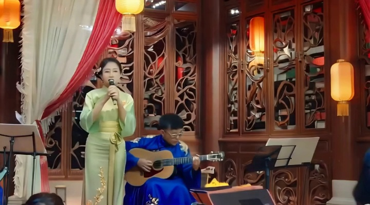
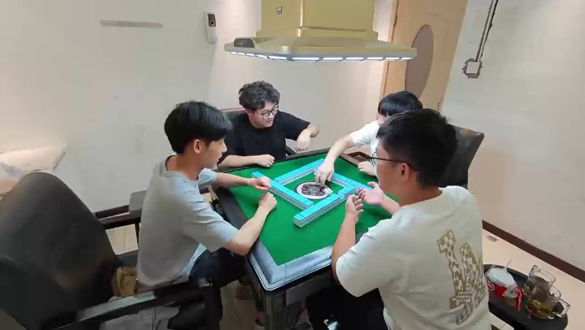
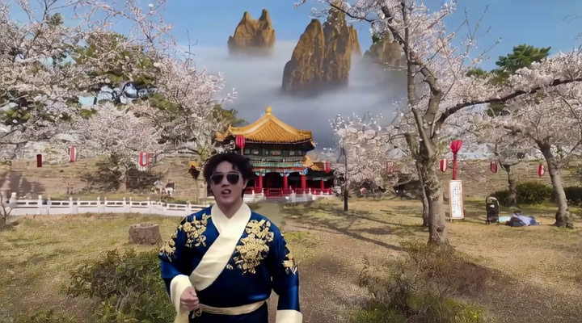
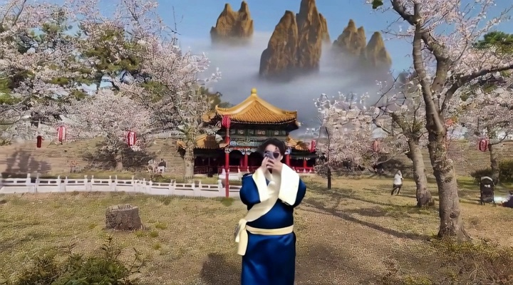

# Sampled visual inspection during maintenance

Scope: eight existing frames opened by the maintainer on 2026-11-01. This is an additional sampled inspection, not an independent model scoring run or full-video/motion verification. Files are unchanged copies; [frame provenance](frame-provenance.json) binds source paths, frame/video hashes, indices and timestamps. All unsampled motion claims in the entries remain attributed to historical reports.

## F003: activity roles at the opening

At frame 0, source shows the standing person extending a handheld microphone toward the seated guitarist. V1 shows the standing performer holding it near her own mouth. V2 shows a stand microphone beside her and a changed seated interaction, without the source's recognizable guitar-playing arrangement. These frames corroborate a changed activity relation. They do not establish continuous gesture trajectories or musical timing.

## F005: the playing system at the opening

The source frame contains a green table surface, rectangular cyan tile walls and a central mechanism. V1 shows a red surface with scattered blue upright pieces and a different center. V2 restores a recognizable green mahjong layout while changing the surround. This corroborates the distinction between theme materials and activity apparatus. It does not establish action preservation or identify a single causal phrase.

## F006: persistence across sampled appearances

V3 frame 0 shows prominent gold floral embroidery across the blue garment's visible chest/shoulders. At frame 112 (112/30 seconds), the exposed blue torso and shoulder regions are largely plain while the cream crossing collar remains. The person is smaller and partly occluded by raised hands/phone; the comparison supports the reported visible pattern change but not a pixel-aligned whole-garment tracking claim. Mountains and pavilion are visible in both samples; their exact floating geometry is not independently scored here.

