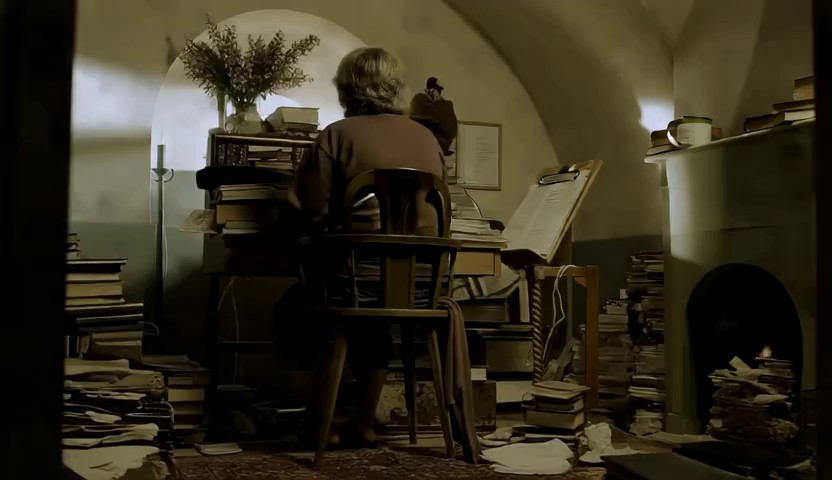
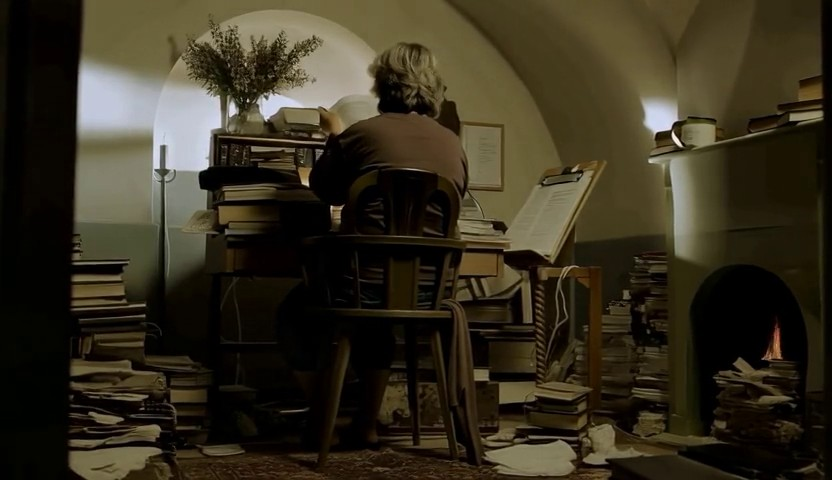
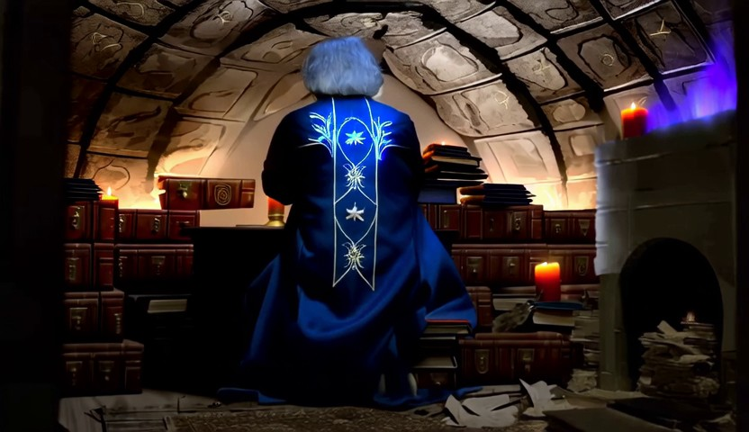
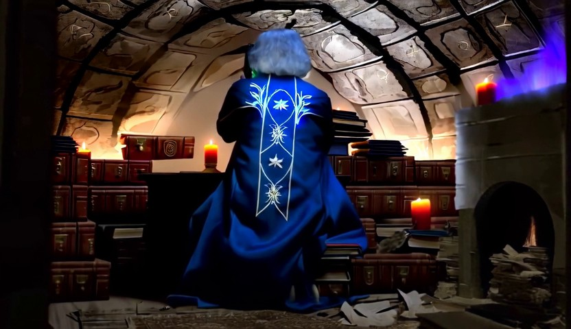

# Fantasy study: authored occlusion and a concrete revision

Historical development case. Interpretation below is human-assisted, not a newly measured result.

## Task

Turn this into a magical fantasy study.

## What this case exposes

Both arms proposed source restart in all three samples. Both removed or reduced an authored robe and excessive book glow; assisted samples consistently used the original fitted jacket shape. Occlusion of chair support does not by itself establish deletion of chair geometry. These intercepted proposals have no new generated outcome.

Read [[wiki-connected-change|the contextual distinction]] or [[case-bernini-003-before-v3-record|the complete actual prompts, reviews and replay decisions]].

## Sampled frame comparisons

These are archived frames already shown to Planner. They support appearance judgments; temporal behavior needs sequence evidence.

[[case-bernini-003-before-v3-source-0|Inspect source at 0.0 seconds]]

[[case-bernini-003-before-v3-source-5|Inspect source at 4.326663 seconds]]

[[case-bernini-003-before-v3-v2-0|Inspect v2 at 0.0 seconds]]

[[case-bernini-003-before-v3-v2-5|Inspect v2 at 4.363636 seconds]]

## Provenance

Recorded prefix SHA256: `825661ca90d50dd0370c089a7d1f8f202ad110a0a1d886f8ba632c926e88774f`.

Replay result SHA256: `19f41296d73e7f6322a33afb7a0b71f8ff4c495cd1c4a5aadea8c2b49b8d0be8`.

Later outcomes in this historical library make this development material. It is not a held-out test case.
