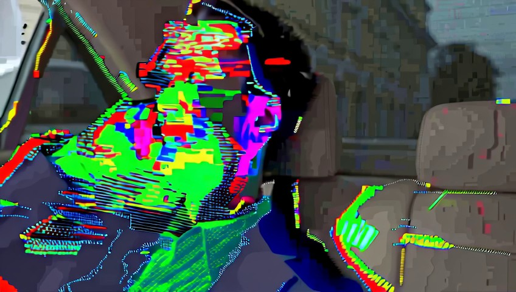
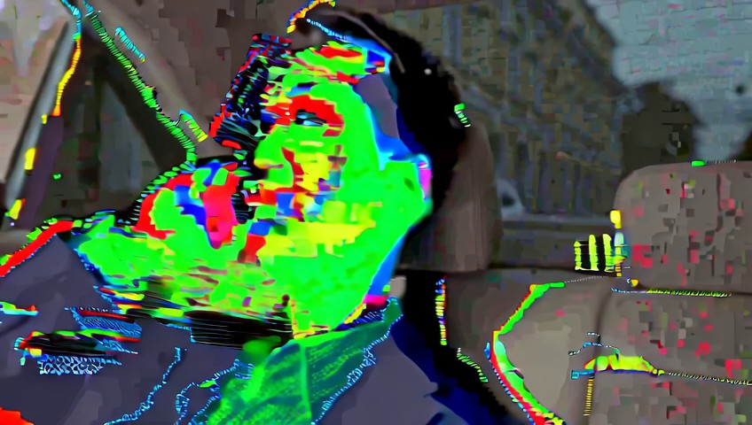

# Glitch: source restart and overlapping realizations

Historical development case. Interpretation below is human-assisted, not a newly measured result.

## Task

Transform the man’s phone call in the beige leather car interior into digital glitch art, with high-contrast shadows and RGB color separation across his navy suit, seats, and window reflections. Apply horizontal pixel shifts, fragmented blocks, and flickering scan-line textures across the entire frame, with distorted color highlights.

## What this case exposes

Both arms proposed source restart in all three samples. New proposals described translucent RGB echoes and picture-bearing strips, overlapping previous prompt demands. Two assisted samples also proposed comparing v1. No new rendering tested whether the revised descriptions changed the failure-producing construction.

Read [[wiki-realization|the contextual distinction]] or [[case-bernini-024-before-v3-record|the complete actual prompts, reviews and replay decisions]].

## Sampled frame comparisons

These are archived frames already shown to Planner. They support appearance judgments; temporal behavior needs sequence evidence.

[[case-bernini-024-before-v3-source-0|Inspect source at 0.0 seconds]]

[[case-bernini-024-before-v3-source-5|Inspect source at 5.0 seconds]]

[[case-bernini-024-before-v3-v2-0|Inspect v2 at 0.0 seconds]]

[[case-bernini-024-before-v3-v2-5|Inspect v2 at 5.0 seconds]]

## Provenance

Recorded prefix SHA256: `c068a79f2d212cfa4be69a65efc6124c73644cfc689c28ddfcf9b9fa5bb1811b`.

Replay result SHA256: `6404b4ce404b0226db517959831564efa0d8b1a1f63c5507136444ab44fe1d22`.

Later outcomes in this historical library make this development material. It is not a held-out test case.
