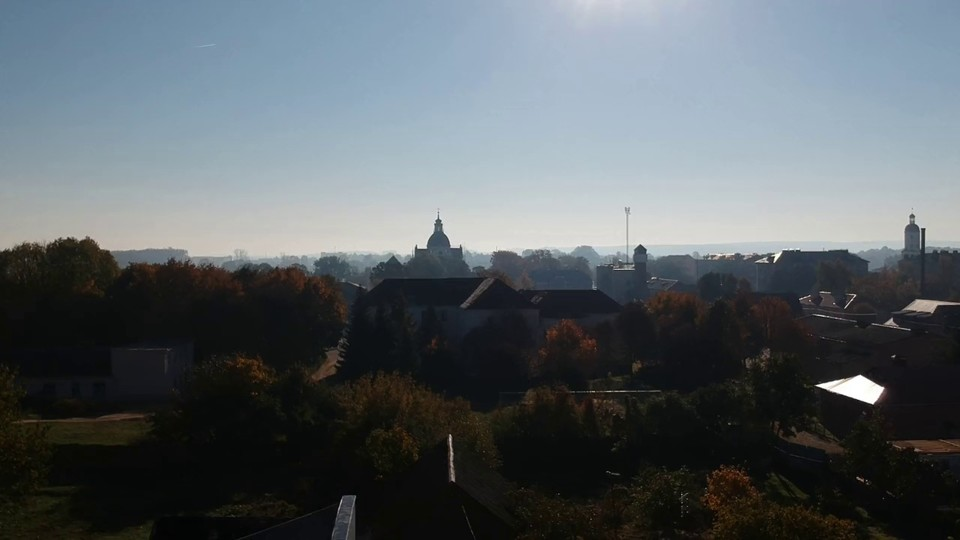
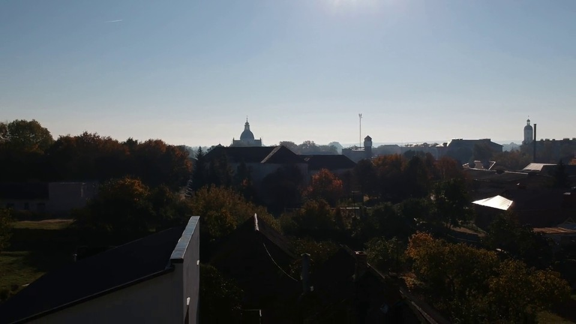
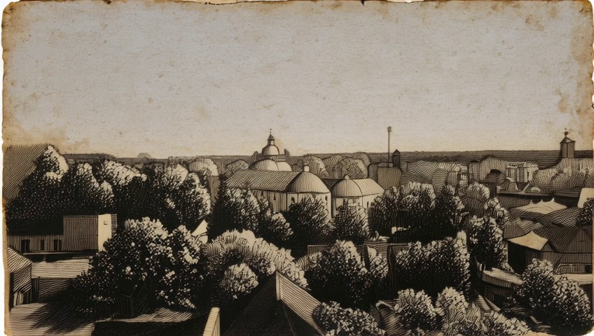
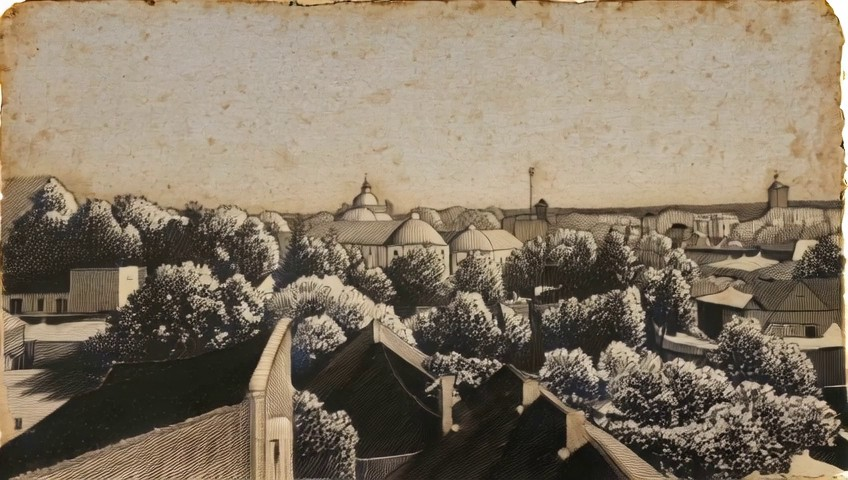

# Etching and architectural identity

Historical development case. Interpretation below is human-assisted, not a newly measured result.

## Task

Make it look like a 19th-century etching.

## What this case exposes

Both replay arms proposed another source generation in all three samples. They treated altered architectural silhouettes as core preservation requirements. The historical online and independent judgments disagree about severity. This case locates a classification question; it does not establish that stopping or regenerating is optimal.

Read [[wiki-scene-identity|the contextual distinction]] or [[case-bernini-027-after-v1-record|the complete actual prompts, reviews and replay decisions]].

## Sampled frame comparisons

These are archived frames already shown to Planner. They support appearance judgments; temporal behavior needs sequence evidence.

[[case-bernini-027-after-v1-source-0|Inspect source at 0.0 seconds]]

[[case-bernini-027-after-v1-source-5|Inspect source at 5.0 seconds]]

[[case-bernini-027-after-v1-v1-0|Inspect v1 at 0.0 seconds]]

[[case-bernini-027-after-v1-v1-5|Inspect v1 at 5.0 seconds]]

## Provenance

Recorded prefix SHA256: `abe37b0242ab2b22600326ca9f2849679e57334cbf6df3da97996ade5402229c`.

Replay result SHA256: `1e56e10fbc12e914bbcbe198c57add0627f6e6d775795719ecf8796f5ae66252`.

Later outcomes in this historical library make this development material. It is not a held-out test case.
