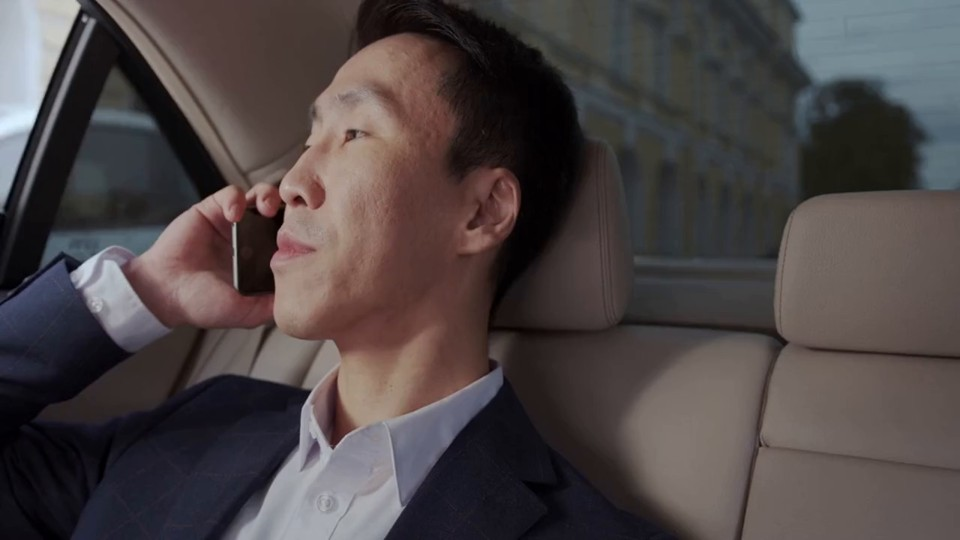
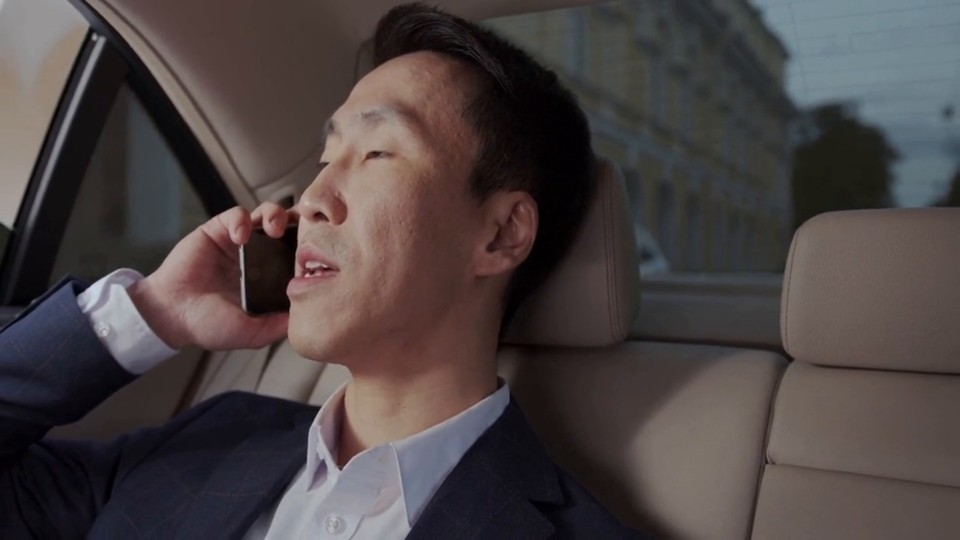
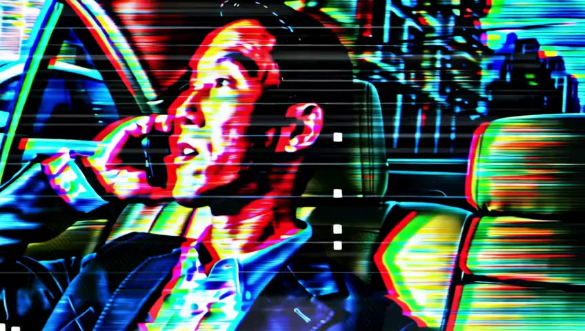
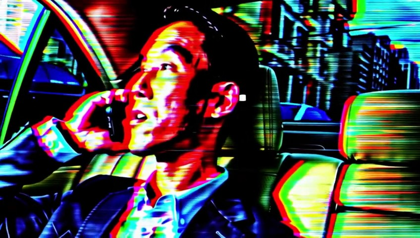

# Glitch: earlier candidate and the retry exception

Historical development case. Interpretation below is human-assisted, not a newly measured result.

## Task

Transform the man’s phone call in the beige leather car interior into digital glitch art, with high-contrast shadows and RGB color separation across his navy suit, seats, and window reflections. Apply horizontal pixel shifts, fragmented blocks, and flickering scan-line textures across the entire frame, with distorted color highlights.

## What this case exposes

Both arms chose v1 in all three samples. All assisted samples read S5 yet continued under a different-realization exception. The previous prompt already requested displaced picture strips and scene-bearing rectangles. Mosaic wording may or may not elicit a different result; this remains untested.

Read [[wiki-realization|the contextual distinction]] or [[case-ditto-024-before-v3-record|the complete actual prompts, reviews and replay decisions]].

## Sampled frame comparisons

These are archived frames already shown to Planner. They support appearance judgments; temporal behavior needs sequence evidence.

[[case-ditto-024-before-v3-source-0|Inspect source at 0.0 seconds]]

[[case-ditto-024-before-v3-source-5|Inspect source at 5.0 seconds]]

[[case-ditto-024-before-v3-v2-0|Inspect v2 at 0.0 seconds]]

[[case-ditto-024-before-v3-v2-5|Inspect v2 at 5.0 seconds]]

## Provenance

Recorded prefix SHA256: `dc6cd03922f7bf9fd994cc3ccf391d5d92416b83aa927c02a24e1fcd41c43540`.

Replay result SHA256: `2cafa68aadd018743f2dea45d4071a3da197e6f06901e36605d5a7f56efee92f`.

Later outcomes in this historical library make this development material. It is not a held-out test case.
